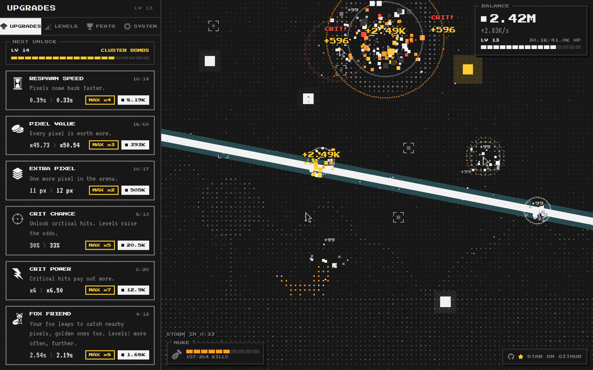
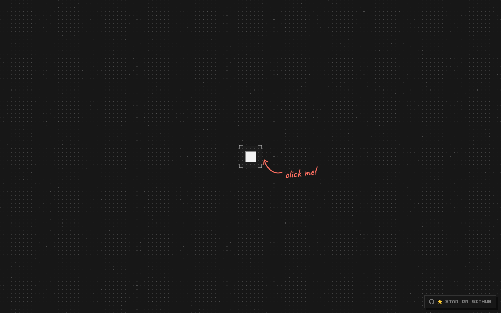
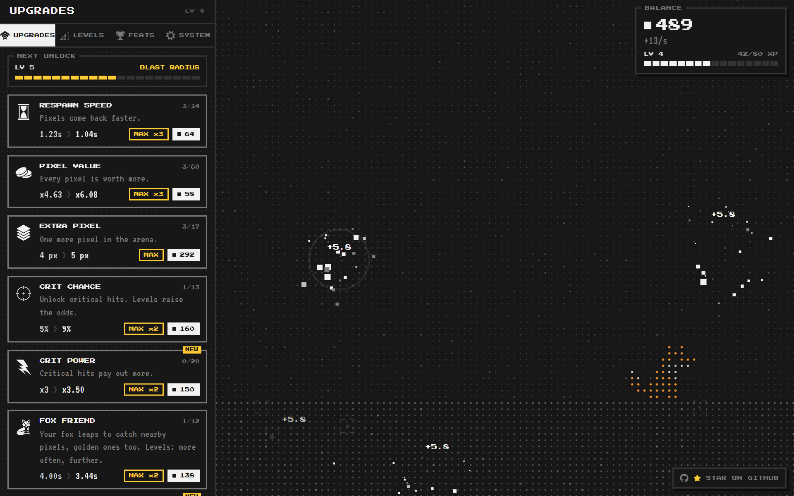
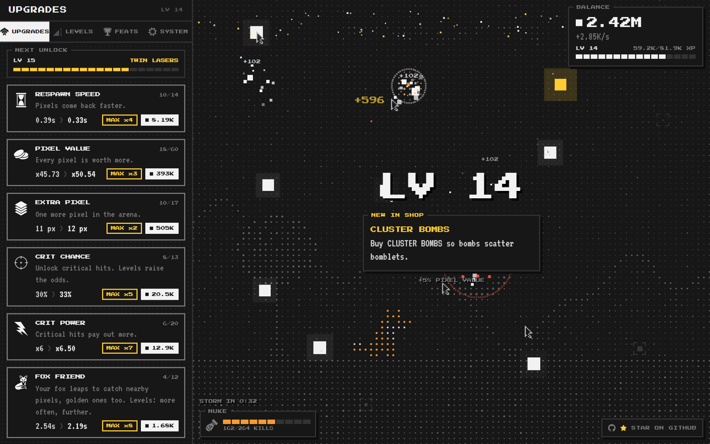
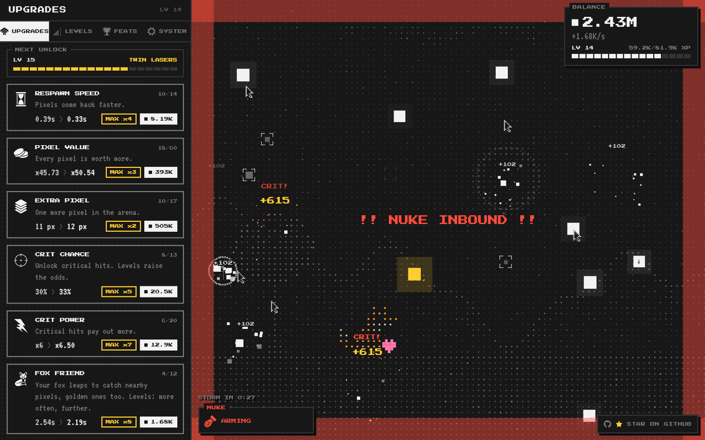
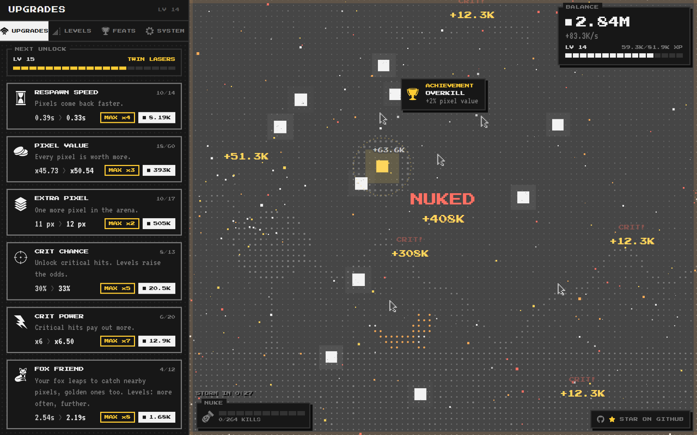
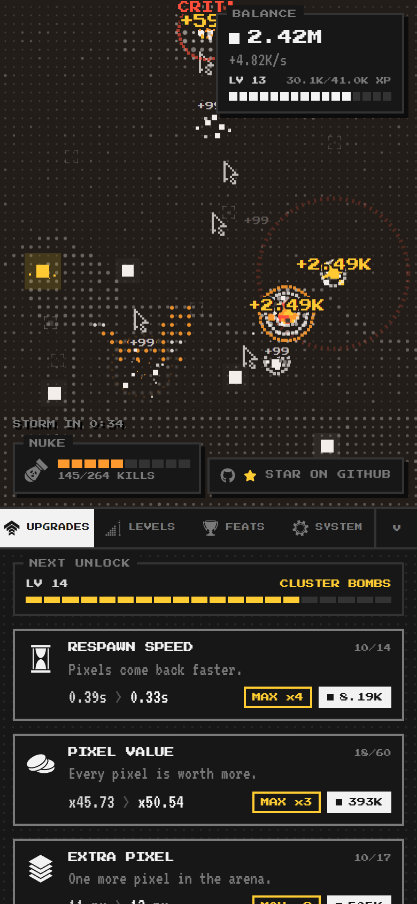
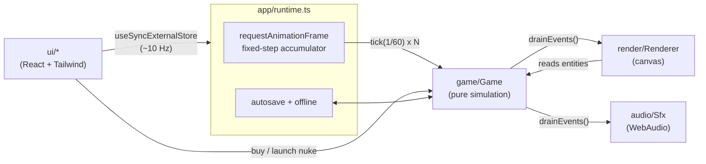

<div align="center">

# OnePixel

**There is one pixel. Click it.**

A retro dot-matrix incremental game about destroying a single pixel, and then a few more, and then rather a lot of them.

[](https://github.com/byalex33/OnePixel/stargazers)




</div>

---

## Contents

- [The idea](#the-idea)
- [How to play](#how-to-play)
- [Features](#features)
- [Screenshots](#screenshots)
- [Progression](#progression)
- [The shop](#the-shop)
- [Pacing](#pacing)
- [Saves and offline progress](#saves-and-offline-progress)
- [Running locally](#running-locally)
- [Architecture](#architecture)
- [Testing and balancing](#testing-and-balancing)
- [Deploying](#deploying)
- [Roadmap](#roadmap)
- [Credits](#credits)

## The idea

The game opens on an empty dot-matrix screen with exactly one pixel in it. There is no tutorial, just a hand-drawn arrow that says *click me!*.

<div align="center">

</div>

Click it and it explodes. You get a pixel. A faint bracket marks where it will come back, and a couple of seconds later it does. That one interaction teaches the whole loop:

```
  pixel appears  ->  you click it  ->  it explodes  ->  +pixels, +XP  ->  it respawns
        ^                                                                     |
        +-------------------------- upgrade, automate, repeat ----------------+
```

From there the arena slowly fills with more pixels, drones, bombs, lasers, storms of falling pixels and, eventually, a nuke.

## How to play

1. **Click (or tap) the pixel.** It explodes and pays out pixels (the currency) and XP.
2. **Wait for it to come back.** Respawning is the first thing you will want to speed up.
3. **Level up.** XP fills the bar in the balance box. Each level adds +5% pixel value and stocks the shop with something new.
4. **Buy upgrades.** The shop opens at level 2. Every new mechanic arrives at level 0 and does nothing until you buy level 1, so you choose what to switch on and when.
5. **Automate.** Drones, bombs and lasers keep destroying pixels while you watch, or while you are away.

Controls: click or tap pixels. Tap a bomb to detonate it early. Tap an upgrade to buy one level, hold it to keep buying, or hit **MAX** to buy every level you can afford.

## Features

**Game feel**
- Chunky pixel-particle explosions, screen shake, hit-stop on crits and floating reward numbers
- Shockwaves that light up the dot-matrix background as they pass
- Combos that recolour the explosions as they climb
- Synthesised chiptune sound effects (no audio files) and haptics on supported phones

**Mechanics**
- Critical hits, combos, explosive taps and chain reactions
- Blue pixels: worth x10 XP, for when you want the next level sooner
- Golden pixels: rare, fleeting, worth x25, and the drones cannot catch them
- Rainbow mode: pop a rainbow pixel and every pixel pays x5 for a few seconds, while the arena and balance box light up like an RGB keyboard
- Auto-destroyer drones that fly to pixels and click them
- Bombs that drop into crowds, orbital lasers, pixel rain storms and a nuke that wipes the board

**World**
- A dot-matrix landscape that grows as you level: ground, mountains, trees, clouds and a moon scan in on the old-monitor arena
- 23 achievements, each worth +2% pixel value
- Upcoming unlocks are previewed; later ones stay hidden behind `???`

**Platform**
- Feels right on phones as well as desktops, with a bottom-sheet shop on mobile
- Local-first saves with autosave, export/import codes, reset, and capped offline progress
- Static site, hosted on Vercel

## Screenshots

<table>
  <tr>
    <td width="50%"><br><sub><b>Early game.</b> The shop opens at level 2; MAX buys every level you can afford.</sub></td>
    <td width="50%"><br><sub><b>Level up.</b> Every level puts something new in the shop.</sub></td>
  </tr>
  <tr>
    <td width="50%"><br><sub><b>Nuke inbound.</b> Charge it with kills, then launch.</sub></td>
    <td width="50%"><br><sub><b>Nuked.</b> Every pixel on screen pays out the warhead yield.</sub></td>
  </tr>
  <tr>
    <td colspan="2" align="center"><br><sub><b>Mobile.</b> Arena on top, shop in a collapsible bottom sheet.</sub></td>
  </tr>
</table>

## Progression

Levels unlock **mechanics**, not stat bumps. Reaching a level stocks the shop; you still have to buy the first level of anything new before it does anything.

<details>
<summary><b>Full unlock list (spoilers)</b></summary>

| Level | Unlock | What it adds |
| --- | --- | --- |
| 2 | Extra pixels | The shop opens. Buy more pixels for the arena. |
| 3 | Critical hits, blue pixels | Crit chance and crit power. Blue pixels worth x10 XP. |
| 4 | Combos | Quick pops stack a multiplier. XP Gain appears too. |
| 5 | Blast radius | Your taps explode and catch nearby pixels. |
| 6 | Auto destroyer | Buy drones that hunt pixels for you. |
| 7 | Golden pixels | Rare x25 pixels that drones cannot catch. |
| 8 | Chain reactions | Destroyed pixels can detonate their neighbours. |
| 9 | Bombs | Bombs drop into crowds. Tap one to set it off early. |
| 10 | Pixel rain | Storms of falling pixels. |
| 11 | Lasers | An orbital beam slices across the arena. |
| 12 | The nuke | Build a silo, charge it with kills, wipe the board. |
| 13 | Drone swarm | Two extra drones. |
| 14 | Cluster bombs | Bombs scatter bomblets. |
| 15 | Twin lasers | Two beams per strike. |
| 16 | Golden storms | Pixel rain carries golden pixels. |
| 17 | Rainbow mode | Rare rainbow pixels; pop one and every pixel pays x5 for a few seconds. |
| 18 | Overclock | Every machine runs 25% faster. |
| 20 | ??? | To be continued. |

</details>

## The shop

| Upgrade | Appears at | Effect |
| --- | --- | --- |
| Respawn Speed | 2 | Pixels come back faster (2.00s down to 0.30s) |
| Pixel Value | 2 | Every pixel is worth more |
| Extra Pixel | 2 | One more pixel in the arena per level |
| Crit Chance / Crit Power | 3 | Unlock critical hits, then make them bigger |
| Blue Pixels | 3 | Blue spawn chance (x10 XP each) |
| Combos / XP Gain | 4 | Combo multiplier and cap; more XP per pixel |
| Blast Radius | 5 | Explosive taps |
| Auto Destroyer | 6 | Drones; every third level adds another |
| Golden Pixels | 7 | Golden spawn chance |
| Chain Reaction | 8 | Chain chance |
| Bomb Bay | 9 | Bomb frequency and blast radius |
| Pixel Rain | 10 | Storm frequency and length |
| Lasers | 11 | Laser frequency |
| Nuke Silo / Warhead Yield | 12 | Build and charge the nuke; nuked pixels pay more |
| Drone Swarm, Cluster Bombs, Twin Lasers, Golden Storms, Overclock | 13 to 18 | One-off perks |
| Rainbow Mode | 17 | Rainbow pixels arrive more often and rainbow mode lasts longer (2s up to 4s) |

Costs grow exponentially per level, so every upgrade stays a choice rather than a checklist.

## Pacing

The game is tuned for roughly the first 20 to 30 minutes of play. Pacing is checked by simulated players (see [Testing and balancing](#testing-and-balancing)):

| Simulated player | First level | Drones unlock | Nuke unlocks | Level at 30 min |
| --- | --- | --- | --- | --- |
| Engaged (3 taps/s) | 0:21 | 2:44 | ~15:00 | 15 |
| Casual (1.2 taps/s) | 0:24 | 4:17 | ~21:40 | 13 |

## Saves and offline progress

- **Local-first.** Progress lives in `localStorage` and autosaves every 15 seconds, on level-ups, and when the tab is hidden or closed.
- **Versioned format** with a migration chain and strict sanitising, so old or hand-edited saves load safely.
- **Export / import** from the SYSTEM tab as a single `ONEPIXEL:` code with a checksum that rejects corrupted or tampered codes.
- **Offline progress** counts only automation (drones, bombs, lasers), runs at 50% efficiency, and is capped at 4 hours.
- **Clock abuse protection.** Offline time is measured from the latest timestamp the game has ever seen, so winding the clock back pays nothing and winding it forward again only pays out once real time catches up. While the tab is merely hidden, the game uses the browser's monotonic clock instead of the wall clock.

## Running locally

Requires Node 22+.

```bash
git clone https://github.com/byalex33/OnePixel.git
cd OnePixel
npm install
npm run dev
```

| Command | What it does |
| --- | --- |
| `npm run dev` | Vite dev server with hot reload |
| `npm run build` | Type-check and build the static site to `dist/` |
| `npm run preview` | Serve the production build locally |
| `npm run typecheck` | TypeScript only |
| `npm run lint` | ESLint |
| `npm test` | Vitest: game maths, progression, saves and pacing |
| `npm run balance` | Run the simulated players and print the levelling timeline |
| `npm run screenshots` | Regenerate the README screenshots (needs `npm run dev` running and Chrome or Edge installed) |

**Dev console.** In development builds the runtime is exposed as `window.op`, which is handy for playtesting:

```js
op.game.grant(0, 50000)        // add XP
op.game.state.pixels += 1e6    // add pixels
op.game.state.level = 12; op.game.refreshStats()
op.reset()                     // wipe progress
```

## Architecture

The simulation knows nothing about React, the DOM or the canvas. It runs on a fixed 60 Hz tick, so progression never depends on frame rate, and it is fully deterministic for a given seed, which is what makes the tests and the balance bot possible.



- **Game** owns all state: pixels, drones, bombs, lasers and the save data. It emits one-shot events (`pop`, `blast`, `levelup`, ...) that the renderer and audio turn into effects.
- **Renderer** draws a pre-rendered dot-matrix backdrop, then live entities, pooled particles, shockwaves and floating text. Everything snaps to a chunky pixel grid. It never mutates game state.
- **Sfx** maps events to named cues synthesised with WebAudio. Swapping in sampled sounds later only changes the cue playback, not the mapping.
- **React** renders the HUD and shop and re-renders on a throttled version counter, not every frame.
- The world has a **constant area** whatever the screen shape, so pixel density, blast radii and balance feel the same on a phone and a widescreen monitor.

```
src/
  game/      simulation: engine, formulas, upgrades, levels, achievements, saves, offline, bot
  render/    canvas renderer, dot-matrix scenery, particles, sprites, palette
  audio/     WebAudio sound cues
  app/       runtime: game loop, autosave, offline progress, links
  ui/        React components (arena, HUD, shop, notices)
scripts/
  screenshots.mjs   headless-browser capture for this README
docs/screenshots/   README images
```

## Testing and balancing

```bash
npm test
```

77 tests cover:

- **Formulas:** cost curves, stat curves, caps, and that every mechanic is off at level 0
- **Engine:** the opening (exactly one pixel), respawning, purchases and MAX buying, level-ups, crits, combos, blasts, drones, blue and golden pixels, rainbow mode, bombs, lasers, chains, the nuke, rain and determinism
- **Saves:** export/import round trips, checksum tampering, version migration, sanitising hostile values, and offline clock-rollback protection
- **Pacing:** two simulated players (engaged and casual) are run through 30 minutes of play, with milestones asserted to land in sensible windows

The simulated player (`src/game/bot.ts`) taps the oldest pixel it can see, buys the cheapest affordable upgrade and launches nukes when ready. `npm run balance` prints its full levelling timeline. It is the quickest way to see what a tuning change does.

## Deploying

OnePixel is a static site.

Hosted on Vercel, configured in `vercel.json` (Vite build, output `dist`).

- **Deploy:** `vercel --prod`, or push to `main` once the GitHub repo is connected in the Vercel dashboard.
- **Caching:** hashed files under `/assets` are cached for a year as immutable; `index.html` uses Vercel's default revalidation, so a new deploy shows up immediately.

## Roadmap

- More of the late game beyond level 20 (something is stirring beneath the grid)
- Prestige / reset layer
- Sampled sound pack and music
- Creatures to share the arena

Ideas and bug reports are welcome in [issues](https://github.com/byalex33/OnePixel/issues).

## Credits

- Fonts: [Press Start 2P](https://fonts.google.com/specimen/Press+Start+2P), [VT323](https://fonts.google.com/specimen/VT323) and [Caveat](https://fonts.google.com/specimen/Caveat), via Google Fonts (SIL Open Font License)
- Icons: [react-icons](https://react-icons.github.io/react-icons/), including [Game Icons](https://game-icons.net/) (CC BY 3.0) and [Font Awesome](https://fontawesome.com/) (CC BY 4.0)
- Built with [Vite](https://vite.dev/), [React](https://react.dev/), [TypeScript](https://www.typescriptlang.org/), [Tailwind CSS](https://tailwindcss.com/) and [Vitest](https://vitest.dev/)

<div align="center">

If OnePixel made you click one pixel too many, consider giving it a **[star on GitHub](https://github.com/byalex33/OnePixel)**.

</div>
